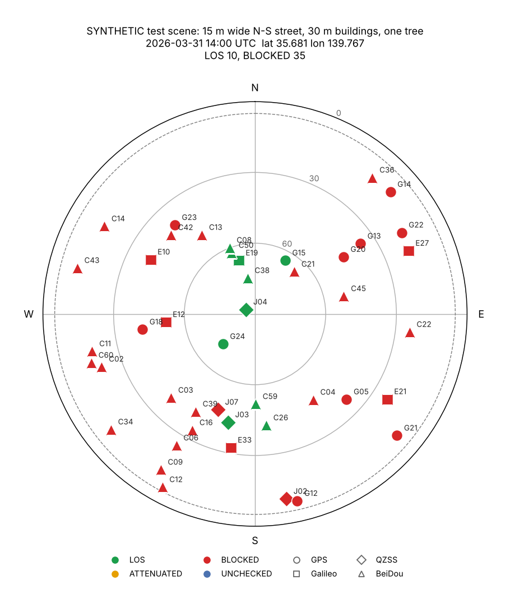
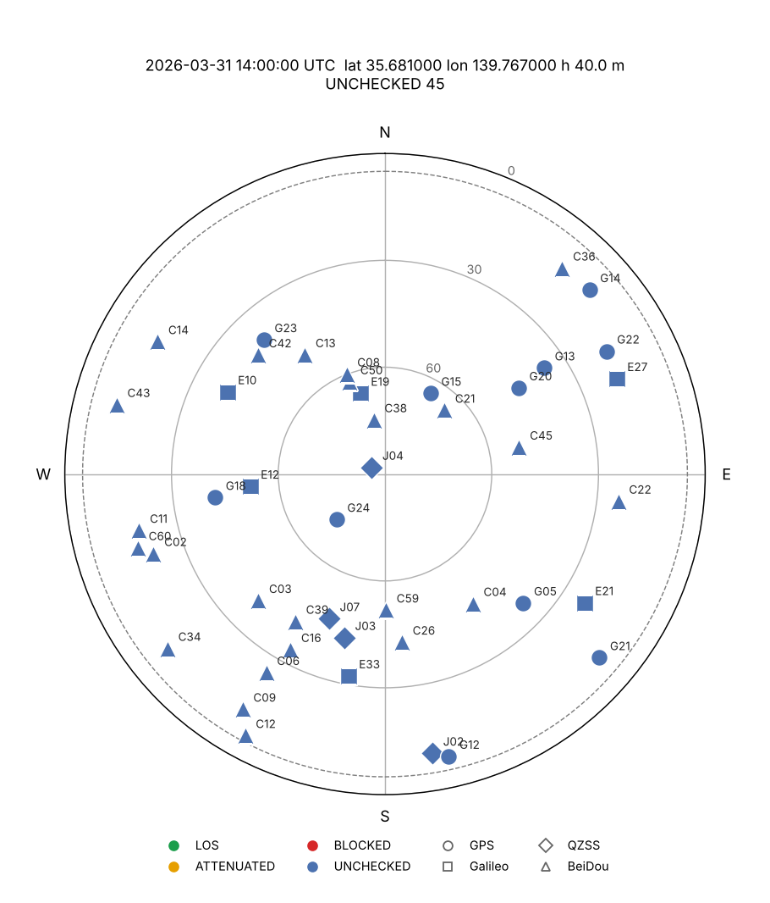

<!--
Title: [Proposal] Satellite-aware GNSS: occlusion (NLOS) from the scene, RINEX ephemerides and directly placed satellites
Category: Ideas (or whichever proposal category the repo uses)
Post at: https://github.com/carla-simulator/carla/discussions/new/choose

TODO before posting:
  1. (done) Prototype pushed: hakuturu583/carla@e0f4fb1.
  2. Run gnss_skyplot.py against a real server (e.g. Town10HD, --draw-rays)
     and attach that sky plot + an in-simulator screenshot of the rays.
     The attached canyon.png is from a SYNTHETIC test scene.
  3. Search Discussions for "GNSS" / "GPS" first (the REST search of issues
     and PRs found nothing related; Discussions could not be searched).
-->

## Problem

`sensor.other.gnss` (and `autoware_gnss`) returns the true position, converted with the OpenDRIVE geo-reference, plus independent Gaussian noise on latitude, longitude and altitude. There are no satellites, so a vehicle in an urban canyon, under a bridge or in a tunnel gets the same fix as one in an open field. That is exactly where localization stacks fail and need testing. Some related details:

- The noise is white and uncorrelated in time. Real GNSS error drifts.
- `noise_lat_stddev` / `noise_lon_stddev` are in degrees and `noise_alt_stddev` is in metres.
- The ROS 2 `NavSatFix` leaves `status`, `service` and `position_covariance` unset.

I searched issues and PRs for GNSS / multipath / NLOS / pseudorange / satellite. The GNSS work so far covers the sensor itself, its noise, geo-projections and coordinate fixes. Nothing simulates satellites. Outside the repo, the University of Minho built CARLA scenes and ray-traced multipath offline, with a MATLAB toolbox generating the measurements ("GNSS Simulation for Automotive: Introducing 3D Scene-Dependent Multipath with CARLA"; *Pervasive and Mobile Computing* 2026). Purdue built a similar Gazebo plugin ([arXiv:2212.04018](https://arxiv.org/abs/2212.04018)). Both show the approach works, but neither runs inside the simulator.

## Proposal

Model GNSS at the measurement level inside CARLA, in phases.

1. **Satellites and occlusion (prototype ready, see below).** Compute satellite positions for the simulated UTC epoch at the map's geo-reference. Then trace one ray per satellite from the antenna through the scene and mark each satellite as line-of-sight, attenuated (vegetation, poles) or blocked (NLOS). This already gives tunnel and bridge outages, and the satellite count and DOP in urban canyons.
2. **Pseudoranges and a position solution.** Generate per-satellite pseudoranges with clock, ionosphere (Klobuchar, from the RINEX header), troposphere and noise models. Drop blocked satellites, or add a delay for a single wall reflection. Solve the position (SPP) and publish it with a real covariance and fix status (`NavSatFix`), so the noise comes from geometry instead of a fixed sigma.
3. **Later.** Diffraction and C/N0, multi-bounce, and RINEX observation output for post-processing.

### Satellite sources (Python API sketch)

Two ways to provide satellites, combinable. In the prototype they are client-side Python classes with this shape:

```python
# A whole constellation from a RINEX 3/4 navigation file, in one call.
# Satellites move along their broadcast orbits as simulation time advances.
world.load_gnss_ephemeris('BRDC00WRD_R_20260900000_01D_MN.rnx')
world.set_gnss_epoch(datetime(2026, 3, 31, 14, 0))   # GNSS time at sim t=0

# Satellites placed directly: deterministic test cases ("one satellite low
# in the east, behind that building") and what-if constellations.
# A direct satellite with the same id overrides the broadcast one.
world.set_gnss_satellites([
    carla.GnssSatellite('X01', azimuth=90.0, elevation=15.0),
    carla.GnssSatellite('G99', ecef=carla.Vector3D(-14657587.6, 18534937.6, 11217467.7)),
])

world.get_gnss_satellites()   # current id, ECEF, azimuth/elevation at the geo-reference
```

The sensor would report per-satellite results, for example `GnssMeasurement.satellites`, a list of `(id, azimuth, elevation, status, [pseudorange])`, next to the position it already reports.

## Prototype

[This commit](https://github.com/hakuturu583/carla/commit/e0f4fb1) ([browse](https://github.com/hakuturu583/carla/tree/e0f4fb1/PythonAPI/examples/gnss)) adds `PythonAPI/examples/gnss/`. It is client-side only and touches no C++.

- `gnss_orbit.py` reads RINEX 3.0x/4.0x navigation files and computes positions for GPS, Galileo, QZSS and BeiDou. BeiDou GEO is included. GLONASS and SBAS are not yet. `SatelliteSet` places satellites directly.
- `gnss_skyplot.py` converts the antenna position to geodetic with `Map.transform_to_geolocation`. It measures the local east/north axes numerically, so any projection and its grid convergence work. It then runs one `World.cast_ray` per satellite and classifies the hit labels. The output is a polar sky plot, JSON, and optional `world.debug` rays. `--watch` follows a vehicle as simulation time advances.
- 21 unit tests run without a server.
  - Satellite positions match `gnss_lib_py` to within 5 mm for GPS and 8 cm for QZSS.
  - Galileo drifts from `gnss_lib_py` by about 1 m/h, which is exactly its use of GPS's GM for Galileo: with that constant swapped, the difference is 7 mm.
  - BeiDou GEO satellites land on their nominal slots.
  - The ray geometry is checked against a fake world containing a building.


*Synthetic test scene, not a CARLA map: a 15 m wide north–south street between 30 m buildings. Only the north–south strip of sky stays in line of sight.*


*Orbit part only (`--offline 35.681,139.767,40`): every satellite above a 5° mask over Tokyo at 2026-03-31 14:00 UTC, with the quasi-zenith QZSS J04 near the centre.*

<!-- TODO: real-map sky plot + in-simulator ray screenshot here -->

## Modules it would touch (phases 1–2)

- **LibCarla**: RPC types for ephemerides and satellites, the satellite propagator (C++ port of the prototype), the measurement model, and the client `World` API.
- **CarlaUnreal plugin**: satellites stored per episode, and line traces in `AGnssSensor::PostPhysTick`, keeping the existing noise path as the default.
- **PythonAPI**: bindings and `docs/*.yml`.
- **ROS 2 publishers**: `NavSatFix` status and covariance, and possibly a per-satellite message.

## Questions for the maintainers

1. Should this extend `sensor.other.gnss` through new attributes (for example `occlusion`, `elevation_mask`), or become a new blueprint such as `sensor.other.gnss_raw`, leaving the current one unchanged?
2. Should satellites belong to the world/episode, shared by every receiver and driven by simulation time, as sketched above?
3. Should the RINEX file be parsed on the client, with the elements sent over RPC, or should the server read a path?
4. Phase 2 needs a position solver. Would RTKLIB (BSD-2) be acceptable as a dependency, or should we keep a small SPP solver in LibCarla?
5. `cast_ray` traces `OverlapChannel` against simple collision. In the shipped towns, building collision is often a coarse hull. Is a dedicated trace channel, or complex collision for GNSS traces, acceptable?
6. Is it OK to bundle a small sample RINEX file (IGS/BKG broadcast ephemeris, CC BY 4.0, 120 KB) for the examples and tests?
